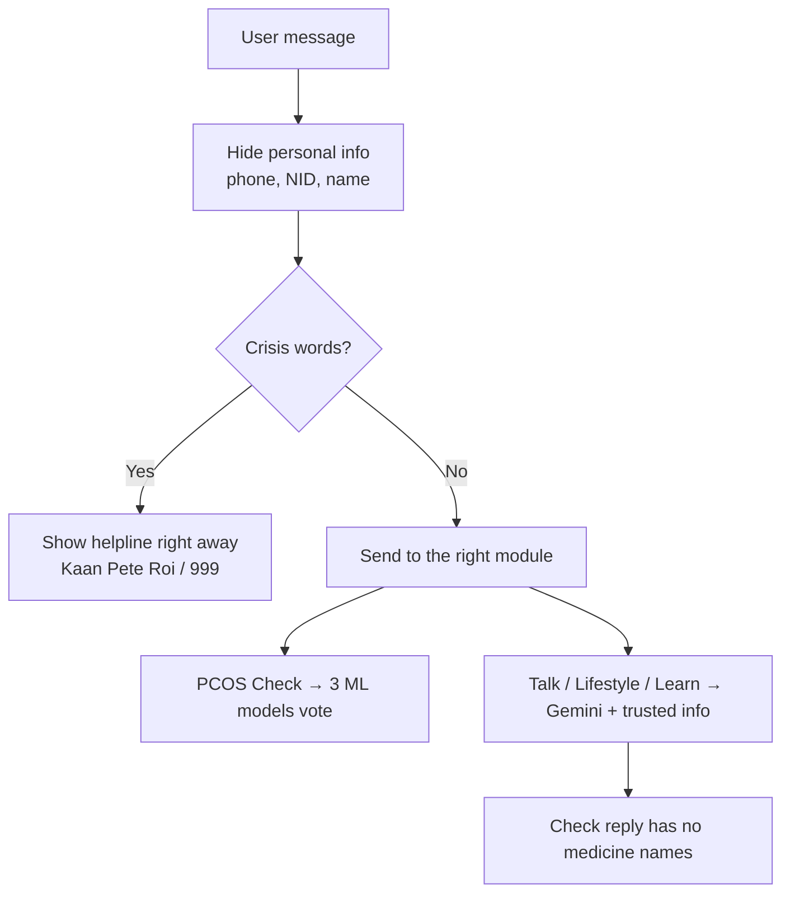

# HRITU (ঋতু) — AI Companion for PCOS & Menstrual Health

<p align="center">
  
  <br>
  A caring, safe AI helper for PCOS awareness and period health.<br>
  Speaks <b>English</b>, <b>বাংলা</b>, and <b>Banglish</b>.<br><br>
  🌐 <b>Live demo:</b> <a href="https://YOUR-APP.vercel.app">https://YOUR-APP.vercel.app</a>
</p>

---

## What is HRITU?

HRITU is a web chatbot that helps women in Bangladesh and South Asia learn about **PCOS** (Polycystic Ovary Syndrome) and period health.

It talks like a kind **elder sister (আপু)** — it does not blame or judge. It **does not diagnose** and **does not prescribe medicine**. It only gives information and points users to a doctor when needed.

It uses **Google Gemini** for chat and three **machine learning models** for the PCOS check.

---

## The 4 Modules

| Module | What it does |
|---|---|
| **1. PCOS Check** | Asks 18 simple questions (plus 5 optional ones), shows the answers for review, then gives a non-diagnostic result. |
| **2. Talk** | A safe space to talk about feelings, body changes, fertility worries, and social pressure. |
| **3. Lifestyle** | Local food and exercise tips (e.g., red rice, shak, local fish). |
| **4. Learn Cycle** | Teaches the 4 phases of the period cycle, with a short quiz. |

---

## How It Works (Simple View)



---

## Safety & Privacy

- **Crisis check first:** If a user writes about self-harm (in English, Bangla, or Banglish), HRITU shows the **Kaan Pete Roi** helpline (`+8801779554391`) and **999** at once — without calling the AI.
- **Personal info is hidden:** Phone numbers, NID numbers, names, and house addresses are removed before anything is sent to the AI. City or district names are kept so advice fits the area.
- **No chat logs saved:** Chats are not stored. Only anonymous PCOS-check answers are saved (to Google Sheets, or a local CSV file if Sheets is not set up).
- **No prescriptions:** AI replies are checked so they never suggest medicines or doses.

---

## Where the Answers Come From

1. **Trusted local cards** — 16 checked health FAQ cards (`backend/knowledge_cards.json`), searched in a few milliseconds.
2. **Web search** — If no card matches, HRITU searches DuckDuckGo for extra information.

---

## The PCOS Check (Machine Learning)

The check uses 10 main inputs: age, BMI, age at first period, cycle length, age when symptoms started, cycle pattern, period delay, symptoms, acne level, and hair loss.

Three models look at the answers:
- Random Forest
- Decision Tree
- Support Vector Machine (SVM)

**If 2 or more models say "yes," the result is "Suspected."** Otherwise it is "Not Suspected."
**SHAP** and **LIME** show which answers mattered most.

---

## Project Folders

```
HRITU_withGEMINI/
├── frontend/            # Web page (HTML, CSS, JavaScript, logo)
├── backend/             # Python server and all AI logic
│   ├── main.py          # Starts the server
│   ├── agent.py         # Talks to Gemini
│   ├── screening.py     # Module 1: PCOS Check
│   ├── sister.py        # Module 2: Talk
│   ├── lifestyle.py     # Module 3: Lifestyle
│   ├── learn.py         # Module 4: Learn Cycle
│   ├── safety.py        # Crisis check and medicine filter
│   ├── privacy.py       # Hides personal info
│   ├── knowledge.py     # Searches the trusted cards
│   ├── knowledge_cards.json
│   ├── preprocessor.py  # Prepares data for the models
│   ├── explainability.py# SHAP and LIME
│   ├── google_sheets.py # Saves results to Google Sheets
│   └── ml models/       # Trained model files (.pkl)
├── requirements.txt     # Python packages
└── vercel.json          # Settings for deploying on Vercel
```

---

## How to Run It

**You need:** Python 3.10+ (3.12 recommended) and a free [Gemini API key](https://aistudio.google.com/).

**1. Download and install**

```bash
git clone https://github.com/<your-username>/<your-repo>.git
cd <your-repo>

python3 -m venv backend/venv
source backend/venv/bin/activate      # Windows: backend\venv\Scripts\activate
pip install -r requirements.txt
```

**2. Add your API key**

Make a file named `.env` inside the `backend/` folder:

```env
GEMINI_API_KEY="your-gemini-api-key"
PRIMARY_MODEL="gemini-flash-latest"
FALLBACK_MODEL="gemini-flash-lite-latest"

# Optional: save results to Google Sheets
GOOGLE_SHEET_ID="your-sheet-id"
GOOGLE_SERVICE_ACCOUNT_JSON='{"type":"service_account", ...}'   # paste the whole JSON text, on one line
```

> ⚠️ Never upload your `.env` file or credentials JSON to GitHub. They are already listed in `.gitignore`.

**3. Start the app**

```bash
cd backend
uvicorn main:app --host 0.0.0.0 --port 8000 --reload
```

Open **http://localhost:8000** in your browser.

---

## Deploy on Vercel

The app is ready for Vercel (`vercel.json` is included).

1. On [vercel.com](https://vercel.com), click **Add New → Project** and import this GitHub repo.
2. In **Settings → Environment Variables**, add the same keys as in `.env` above (at least `GEMINI_API_KEY`).
3. Click **Deploy**.

After this, every `git push` to `main` updates the live site automatically.

> Note: On Vercel, the local CSV backup does not work (the server can't save files). Set up Google Sheets if you want to keep screening results.

---

## Disclaimer

**HRITU is for awareness only. It is NOT a medical device and does NOT diagnose.**
Its results are based on what users type in. Anyone with strong pain, low mood, or ongoing symptoms should see a gynecologist, endocrinologist, or mental health professional.

---

<p align="center">© 2026 HRITU • Accessible AI for Women's Health</p>
