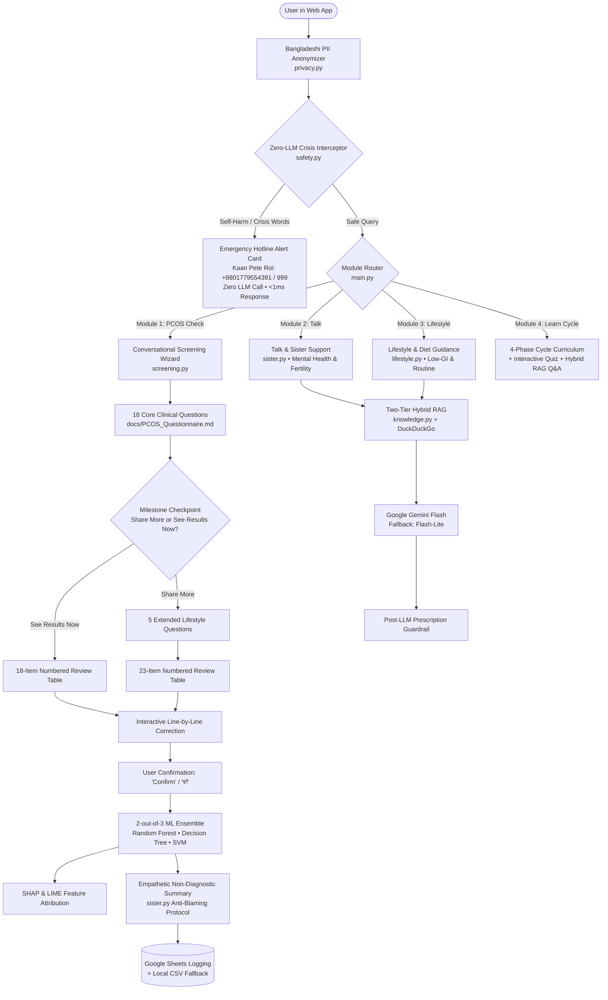

# HRITU (ঋতু) — Advanced Women's Health & PCOS AI Companion

<p align="center">
  
  <br>
  <strong>A Culturally Empathetic, Medically Guardrailed AI Companion for PCOS Awareness & Menstrual Health</strong><br>
  Powered by Google Gemini Flash (with Flash-Lite Fallback) • 2-out-of-3 ML Ensemble (RF + DT + SVM) • SHAP & LIME Explainability<br>
  Two-Tier Hybrid RAG (<5ms Local Cards + Live DuckDuckGo) • Zero-LLM Crisis Interceptor • Bangladeshi PII Anonymizer<br>
  Web Application • English / বাংলা / Banglish
</p>

---

## 🌟 What is HRITU?

**HRITU (ঋতু)** is an enterprise-grade, culturally sensitive AI healthcare companion developed to address the widespread diagnostic delays and social taboos surrounding **Polycystic Ovary Syndrome (PCOS)** and menstrual irregularities, with a specialized focus on South Asian and Bangladeshi women.

Unlike generic chatbots or cold diagnostic forms, HRITU adopts an **anti-blaming "Elder Sister" persona (*Apu / আপু*)**, speaking fluently in **English**, **বাংলা (Bangla)**, and **Banglish**. She never diagnoses or prescribes medication, but instead guides users through clinical pattern checks, evidence-based lifestyle modifications, fertility awareness, and cycle education.

---

## 🏛️ System Architecture



---

## 🧩 The Four Specialized Modules

| # | Module | Core Functionality | Technologies & Engines |
|---|---|---|---|
| **1** | **PCOS Check** (`screening.py`) | Guided clinical slot-filling assessment across 18 core features, optional milestone branch, numbered review table, single-turn line editing, and non-diagnostic evaluation. | 18-Question Wizard, 2-of-3 ML Ensemble (RF, DT, SVM), SHAP & LIME, Google Sheets API |
| **2** | **Talk** (`sister.py`) | Compassionate, stigma-free conversational sanctuary for emotional wellness, physical changes, fertility fears, and societal pressure. | Elder Sister Persona, Google Gemini Flash, Anti-Blaming Guardrail, Strictly Female TTS |
| **3** | **Lifestyle** (`lifestyle.py`) | Culturally grounded nutrition advice (*Lal Chal, Shak, local fish*), glycemic balance, and sustainable movement without unsolicited lecture dumps. | Two-Tier Hybrid RAG, DuckDuckGo Search, `sister.py` Anti-Blaming Guardrail |
| **4** | **Learn Cycle** (`learn.py`) | Step-by-step 4-phase cycle curriculum (Menstrual, Follicular, Ovulatory, Luteal), interactive knowledge quiz with quick chips, and open Q&A. | Interactive Curriculum Engine, Quick-Reply Chips, Two-Tier Hybrid RAG |

---

## 🛡️ Patient Safety & Privacy Guardrails

### 1. Zero-LLM Suicide / Crisis Interceptor ([`safety.py`](file:///Users/ftniloy/Downloads/PCOS%20AI%20Agent/backend/safety.py))
- **Deterministic Pre-Filter**: Operates in sub-millisecond time before hitting any cloud LLM, ensuring guaranteed reliability even during network disconnects or API outages.
- **Multilingual Distress Lexicon**: Screens English, native Bengali script (e.g., *বাঁচতে চাই না*, *মরে যেতে চাই*, *আত্মহত্যা*), and transliterated Banglish (e.g., *ami more jete chai*, *bachte chai na*).
- **Direct Emergency Card**: Immediately returns the verified **Kaan Pete Roi (কান পেতে রই)** mental health helpline (`+8801779554391`) and national emergency line **999** with prominent red-bordered emergency styling (`is_crisis: true`).

### 2. Bangladeshi PII Anonymizer ([`privacy.py`](file:///Users/ftniloy/Downloads/PCOS%20AI%20Agent/backend/privacy.py))
- **In-Flight Sanitization**: Masks telephone numbers (supporting both ASCII digits `01...`, `+8801...` and native Bangla digits `০-৯`), national identity numbers (NID), self-introductions, and street/flat micro-addresses.
- **Habitat & Location Preservation**: Explicitly protects broader geographic identifiers (Bangladesh, divisions like Dhaka, Sylhet, Chittagong, districts, and habitat terms) so the AI can provide authentic, locally accessible dietary and lifestyle advice.
- **Zero Raw Chat Persistence**: Patient conversations are **never logged to local disk**. Only anonymous, structured clinical feature rows are synchronized with Google Sheets (with local CSV fallback).

### 3. Post-LLM Prescription Guardrail
- Automatically inspects outbound AI responses to prevent unauthorized pharmaceutical prescriptions or medical dosages (e.g., Metformin, Letrozole, Clomiphene, Diane-35), cleanly redirecting users to licensed healthcare professionals.

---

## ⚡ Two-Tier Hybrid RAG Architecture

HRITU implements a high-performance **Two-Tier Retrieval-Augmented Generation (RAG)** pipeline across Modules 2, 3, 4, and General Chat:

1. **Tier 1 (Local Verified Knowledge Cards — `<5ms`)**:
   - 16 curated, physician-aligned medical FAQ cards stored in [`backend/knowledge_cards.json`]
   - Scanned via an in-memory scikit-learn TF-IDF vectorizer using character n-grams `char_wb(2,4)` to seamlessly handle spelling variations across English, Bangla, and Banglish.
2. **Tier 2 (Live DuckDuckGo Medical Search)**:
   - When user queries require broader context or do not hit a verified card, the engine falls back to live DuckDuckGo web search via the `ddgs` library.
   - Enriched with medical domain keywords, URL references, and protected by a 2.5-second thread safety timeout.

---

## 🤖 Machine Learning Ensemble & Explainability

### 10 Mandatory Prediction Features
For machine learning evaluation, all 10 clinical features are gathered via the Module 1 wizard:

| # | Feature Key | Data Type | Clinical Significance |
|---|---|---|---|
| 1 | `age` | Float (years) | Age distribution & baseline hormonal norms |
| 2 | `bmi` | Float ($kg/m^2$) | Computed directly from height & weight |
| 3 | `age_at_first_period` | Float (years) | Menarche age |
| 4 | `menstrual_cycle_length_days` | Float (days) | Cycle frequency (Rotterdam criterion) |
| 5 | `age_first_symptoms` | Float (years) | Symptom onset timeline |
| 6 | `cycle_pattern` | Categorical | Regular, Irregular, or Absent |
| 7 | `period_delay` | Categorical | Frequency and extent of delayed menses |
| 8 | `symptoms` | Multi-label List | Weight gain, hirsutism, oily skin, delays |
| 9 | `acne_severity` | Categorical | None, Mild, Moderate, or Severe |
| 10 | `hair_loss` | Categorical | None, Mild, Moderate, or Severe |

### 2-out-of-3 Majority Ensemble Voting
- **Random Forest (`rf_trained_model.pkl`)**: 341 one-hot encoded features.
- **Decision Tree (`dt_pcos_model.pkl`)**: 341 one-hot encoded features.
- **Support Vector Machine (`svm_pcos_model.pkl`)**: 315 standard-scaled features.
- **Ensemble Rule**: If 2 or more models predict positive/suspected $\rightarrow$ **`Suspected / Chance of condition`**; otherwise $\rightarrow$ **`Not Suspected / Minimal chance`**.
- **Explainability**: SHAP (SHapley Additive exPlanations) and LIME (Local Interpretable Model-Agnostic Explanations) generate transparent feature-importance rankings explaining the observation.

---

## 📁 Repository Structure

```
PCOS AI Agent/
├── frontend/                       # Client web application
│   ├── index.html                  # Responsive landing page, chat room, quick chips, modals
│   └── static/
│       ├── styles.css              # Vanilla CSS design system, glassmorphism, responsive styles
│       ├── app.js                  # State manager, bilingual dictionary, strictly female TTS
│       └── logo.jpg                # Application avatar
├── backend/                        # FastAPI application & clinical engines
│   ├── main.py                     # FastAPI server, REST routing, ML hand-off, sheets persistence
│   ├── agent.py                    # LangChain conversation engine, Gemini Flash, hybrid RAG
│   ├── screening.py                # Module 1: 18-question slot filling wizard, milestone, table parser
│   ├── sister.py                   # Module 2: Talk support, empathy protocols, anti-blaming
│   ├── lifestyle.py                # Module 3: Nutrition, workout, routine, hybrid RAG
│   ├── learn.py                    # Module 4: 4-phase period cycle curriculum & quiz engine
│   ├── safety.py                   # Zero-LLM crisis interceptor, hotline dispatcher, medicine filter
│   ├── privacy.py                  # Bangladeshi PII anonymizer (phone, NID, name) with geo-whitelist
│   ├── knowledge.py                # Tier 1 TF-IDF char n-gram local card matching engine
│   ├── knowledge_cards.json        # 16 verified clinical knowledge cards in English & Bangla
│   ├── preprocessor.py             # Feature engineering & scaling for RF, DT, and SVM
│   ├── explainability.py           # SHAP & LIME local and global feature attribution
│   ├── google_sheets.py            # Asynchronous Google Sheets service account sync
│   ├── collected_pcos_data.csv     # Local offline fallback database for screening records
│   └── ml models/
│       ├── rf_trained_model.pkl    # Trained Random Forest classifier
│       ├── dt_pcos_model.pkl       # Trained Decision Tree classifier
│       ├── svm_pcos_model.pkl      # Trained Support Vector Machine classifier
│       ├── svm_scaler.pkl          # Standard scaler for SVM
│       └── *_training_columns.pkl  # Exact column references for feature alignments
├── docs/                           # Architecture, guides & clinical specifications
│   ├── PCOS_Questionnaire.md       # Clinical intake questionnaire design specification
│   ├── PCOS_AI_Agent_mechanism.mmd # Architecture Mermaid diagram specification
│   ├── PCOS_AI_Agent_mechanism.png # High-resolution architecture visual diagram
│   ├── Report.md                   # Comprehensive technical evaluation report for developers
│   └── explain.md                  # Beginner-friendly, jargon-free guide
├── README.md                       # Repository overview & quickstart (this file)
└── requirements.txt                # Python package dependencies
```

---

## 📚 Documentation & Technical Guides

Detailed architectural blueprints, clinical evaluation reports, and user guides are organized in the [`docs/`](docs/) directory:

- 📖 [**Beginner-Friendly Guide (`docs/explain.md`)**](docs/explain.md) — A simple, non-technical explanation of how HRITU works using everyday analogies.
- 🔬 [**Comprehensive Technical Report (`docs/Report.md`)**](docs/Report.md) — Deep dive for developers into ML ensembles, RAG latency benchmarks, and clinical safety.
- 📐 [**System Architecture Diagram (`docs/PCOS_AI_Agent_mechanism.mmd`)**](docs/PCOS_AI_Agent_mechanism.mmd) — Full Mermaid flowchart specification.
- 📋 [**Clinical Intake Specification (`docs/PCOS_Questionnaire.md`)**](docs/PCOS_Questionnaire.md) — Exact 18 core and 5 extended clinical intake questions.

---

## 🚀 Quickstart & Local Setup

### 1. Prerequisites
- Python 3.9+ (Python 3.10+ recommended)
- A [Google Gemini API Key](https://aistudio.google.com/) (`GEMINI_API_KEY` or `GOOGLE_API_KEY`)
- (Optional) Google Service Account JSON for live cloud spreadsheet syncing

### 2. Installation

```bash
# Clone the repository
git clone https://github.com/ftniloy5757/aiSIS_byNILOY.git
cd "PCOS AI Agent"

# Create and activate virtual environment
python3 -m venv backend/venv
source backend/venv/bin/activate

# Install required dependencies
pip install -r requirements.txt
```

### 3. Environment Configuration
Create a `.env` file in the `backend/` directory:

```env
GEMINI_API_KEY="your-gemini-api-key-here"
PRIMARY_MODEL="gemini-flash-latest"
FALLBACK_MODEL="gemini-flash-lite-latest"

# Optional: Google Sheets Logging
GOOGLE_SHEET_ID="your_google_sheet_id"
GOOGLE_SERVICE_ACCOUNT_JSON="pcos-ai-agent-credentials.json"
```

### 4. Running the Application

```bash
cd backend
./venv/bin/uvicorn main:app --host 0.0.0.0 --port 8000 --reload
```

Access the interactive web platform at: **`http://localhost:8000`**

---

## ⚖️ Clinical & Ethical Disclaimer

**HRITU is an informational and health-awareness tool, NOT a diagnostic medical device.** It does not provide medical diagnoses, treatment prescriptions, or clinical therapy. Any observation generated is an algorithmic pattern assessment based on self-reported inputs. Users experiencing severe pain, depression, or persistent symptoms must always consult a licensed gynecologist, endocrinologist, or mental health specialist.

---

<p align="center">
  © 2026 - HRITU TN. • Advancing Accessible AI for Women's Health
</p>
